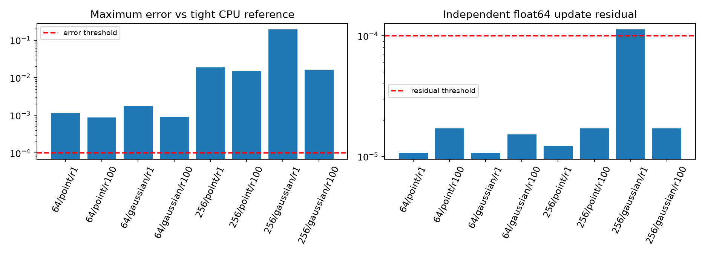
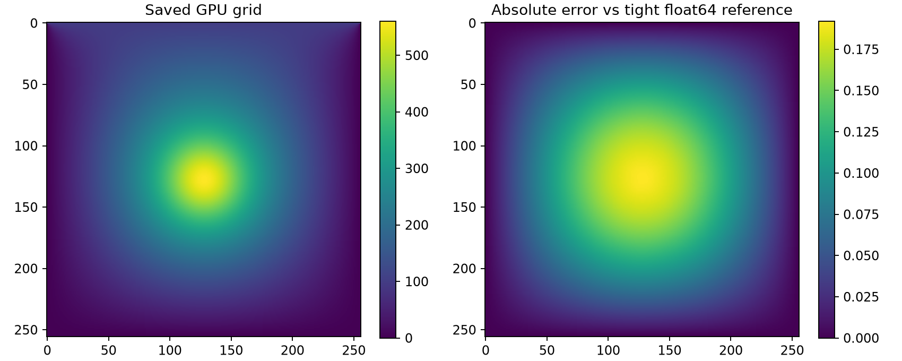
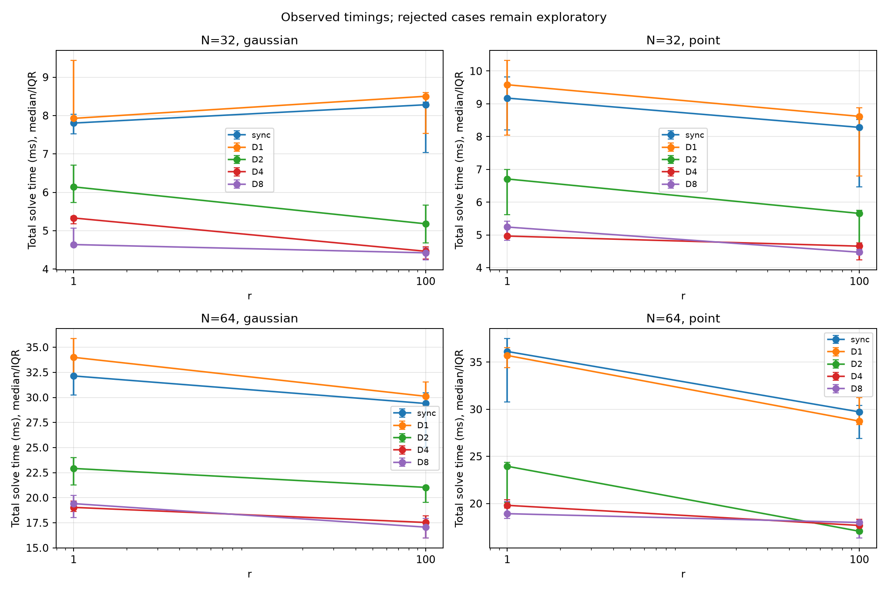
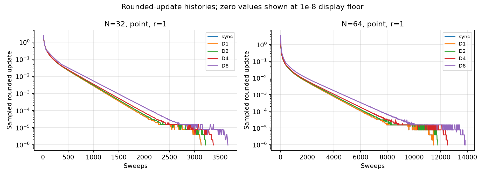

# CUDA Jacobi Relaxation with Delayed Block Halos and Strategy Selection

**PCAP project — Manipal Institute of Technology, MAHE**
Bhavana Peri (Roll 6, Reg. 240905034), Medhavi Mehta (Roll 21, Reg. 240905122), Vaibhav Bhatia (Roll 52, Reg. 240905504)
Repository: `async-stencil-jacobian` · Prepared 13 October 2026


## Abstract

This project compares a synchronous CUDA five-point Jacobi relaxation with block-local variants that perform D=1,2,4,8 shared-memory sweeps between halo refreshes. The current implementation uses separate global input/output buffers and a global kernel boundary after each local round. The study also implements an offline decision-tree selector. A central finding is that convergence of the rounded float32 update does not establish convergence of the independently evaluated discrete equation: representative runs can stop with zero update while retaining a nonzero float64 residual and appreciable solution error. We therefore distinguish execution success, solver-reported convergence, independent residual acceptance, and reference-grid agreement. Performance measurements failing numerical acceptance are treated as exploratory. The final study collected 280 repeated measurements, but none met all accuracy checks; consequently no new performance-based ML model was trained. All tables and plots use saved measurements only.

## 1. Objectives and scope

The objectives are to implement a synchronous baseline, quantify the effect of delayed block halos on work and runtime, validate final grids independently, and demonstrate how pre-runtime problem features can select a strategy when enough accurate timing data exist. This is an empirical single-GPU PCAP study, not a new convergence theorem or a production PDE solver. The current GPU is an NVIDIA GeForce RTX 5050 Laptop GPU; the README's original RTX 5060 target does not describe the measured hardware.

The deadline-bounded submission preserves the existing float32 solvers. It does not reinterpret a small rounded update as an accuracy certificate. The eight diagnostic configurations use N=64/256, point/Gaussian sources and r=1/100; the repeated performance subset is specified in Section 6. Older experiments and ML artifacts remain preserved but are not promoted to independently validated results.

## 2. Equation, discretization and implemented numerical method

The motivating diffusion equation is

```text
du/dt = alpha * (d²u/dx² + d²u/dy²) + f.
r = alpha * dt / h²;    s = dt * f.
```

The code stores an N×N row-major grid, with interior indices 1 through N−2. It applies

```text
u_new[i,j] = (u[i,j] + r*(north + south + west + east) + s[i,j])/(1+4r).
```

**Important formulation distinction:** the self-value on the right is the current iterate, not a fixed previous-time-step value. Although the expression resembles an implicit transient update, the implemented repeated solve converges toward a steady discrete equation:

```text
r * (4*u[i,j] − north − south − west − east) = s[i,j].
```

It is weighted Jacobi for that steady equation, with weight `omega=4r/(1+4r)`. A genuine backward-Euler time step would retain a separate fixed previous-time-step right-hand side; this project does not implement that time evolution. Changing r affects both the relaxation weight and the steady source-to-diffusion balance because the source peak remains fixed.

Initially, all interiors are zero. The top edge y=0 is 100, including its two corners; the bottom edge and non-top left/right cells are zero. A point source has one unit sample at `(floor(N/2),floor(N/2))`. The Gaussian has the same center and peak, with `sigma=N/16` cells for the measured sizes. Sources are zero on the boundary. CPU validation promotes the existing float32 source samples into float64 instead of defining a new source distribution.

## 3. CUDA implementations

### 3.1 Synchronous baseline

`sync_jacobi.cu` assigns one thread per cell in 32×8 blocks. Two device grids carry identical fixed boundaries. A kernel reads one grid, writes interior results to the other, and the host swaps the pointers. Default-stream kernel ordering supplies a global sweep boundary. The optional residual reduction takes a warp maximum, a shared block maximum, then one atomic maximum per block. Nonnegative float bit patterns support this maximum reduction.

### 3.2 D1/D2/D4/D8 delayed-halo solver

`async/async_kernel.cuh` loads each 32×8 tile and its one-cell halo into two shared-memory buffers. It performs up to D local Jacobi sweeps with the external halo held fixed, using a block barrier after every shared-memory update, and writes the resulting tile to a separate global output buffer. The host then swaps global buffers. D1 is mathematically synchronous Jacobi. D>1 exchanges halo information less frequently and generally changes the transient iteration sequence.

The **current host implementation is race-free delayed-halo block Jacobi**, not unrestricted in-place asynchronous relaxation. There is a grid-wide kernel boundary after each round. Kernel comments describing in-place reads of neighbours' mid-update values belong to an older design and are not the current execution path. Classical asynchronous-iteration literature motivates the synchronization trade-off, but its general convergence claims are not substituted for validation of this implementation [1,2].

The convergence-mode scheduling helper shortens rounds at multiples of the requested residual interval M and at the cap. For M=10, D4 launches 4,4,2 sweeps and D8 launches 8,2. Iteration counts measure local sweeps performed per cell, not kernel launches. Positive `--iters K` selects a fixed-work diagnostic mode, executes exactly K sweeps and leaves `converged=false`.

## 4. Hardware, build and profiling methodology

The measured GPU is an RTX 5050 Laptop GPU with 20 SMs, compute capability 12.0, and 32×8 tiles (256 threads). Runtime occupancy diagnostics report six resident blocks per SM and 100% theoretical occupancy for the measured kernels. This is a resource-limit calculation, not measured achieved occupancy. N32 and N64 grids contain only 4 and 16 blocks respectively, fewer than the 20 SMs, so these small-grid timings are dominated by launch/checkpoint costs and do not establish large-grid scalability.

The established CUDA compilation commands are:

```bash
nvcc -O3 -arch=sm_120 -fmad=false -I async sync_jacobi.cu -o build/sync_jacobi
nvcc -O3 -arch=sm_120 -fmad=false async/async_solver.cu -o build/async_jacobi
```

GPU binaries were preserved for this final study rather than rebuilt without need. Source/binary hashes and toolchain records accompany the results. Measured NVIDIA driver version is 610.57.04; nvcc is CUDA 13.3, V13.3.73; NVIDIA-SMI reports 8151 MiB device memory. `-fmad=false` aligns arithmetic evaluation more closely with the CPU update; it does not eliminate all rounding effects. NVIDIA documents operation ordering and floating-point precision considerations [3,4]. Historical Nsight and block-size measurements remain in `results/`, but they include an older plain-neighbour-averaging solver and are not used as achieved profiling measurements for this corrected equation.

## 5. Convergence, precision and independent validation

The solver tolerance used in the final study is 1e−6, sampled every ten sweeps, with at most 2,000,000 sweeps. Sync stops on the maximum absolute float32 sweep update. Async first samples the final local sweep update, then verifies a candidate grid with the host `true_max_update`; its arithmetic is still float32 although the returned maximum is a double. Necessary candidate verification remains part of solving.

The independent validator computes, in float64,

```text
rho(u) = max_interior |(u + r*neighbour_sum + s)/(1+4r) − u|.
```

The unnormalized discrete equation defect is `(1+4r)*rho`, up to rounding. Neither residual directly bounds the maximum solution error. The validator requires finite supported arrays, exact prescribed boundaries on both candidate and reference grids, `rho<1e−4` for each, and `max|u_gpu−u_reference|≤1e−4`. RMSE is also reported. A grid compared with itself has zero grid error but can still fail its independent residual.

The CPU reference defaults to float32 to preserve exact-iteration comparisons. Explicit `--precision float64` uses the same Jacobi method and requires both the sampled update and completed-grid independent residual to meet tolerance before reporting convergence. Final CPU JSON distinguishes the last sampled `final_residual`, its `final_residual_iteration`, and the completed-grid `final_true_residual`; an unsampled update serializes as null. Non-finite parameters/sources and unsupported grid shapes/dtypes are rejected. Boundary and strict-JSON regressions are included in the tests.

For diagnosis, the eight existing GPU configurations are compared with tighter float64 references at tolerance 1e−10. No GPU rerun is needed for those comparisons. The N256 Gaussian/r1 float32 grid previously stopped at 137,170 sweeps with update zero, independent residual about 1.1276e−4, and maximum value near 560.7. The spacing of float32 numbers around the worst cell is about 6.10e−5. Twenty additional rounded CPU sweeps produced zero change. This is stagnation of the rounded map, not evidence that the discrete equation has been solved to 1e−6.

## 6. Timing contract and benchmark reproducibility

The primary measurement is CUDA-event elapsed time spanning the complete solver loop. Setup, context creation, allocation, initial transfers, warm-up, post-loop final transfer/residual evaluation, output dumps and independent CPU-reference comparisons are excluded. Iteration kernels, scalar residual transfers and necessary stopping decisions inside the loop are included.

**Timing-workload asymmetry:** async's candidate transfer and host residual verification are inside its event interval, whereas Sync does not perform that check. Their stopping semantics differ, so deleting or moving the async check would weaken correctness and adding it to Sync could alter its behavior. We preserve total required solve cost, disclose the asymmetry, and do not call the comparison an equal-work pure-kernel benchmark. External validation is excluded for every strategy. No GPU timing boundary is changed for this submission.

The compact repeat study uses fresh files only and records raw solver JSON, residual histories, commands, grids, validator JSON, numerical flags, source/binary hashes, and median/IQR/min/max runtime. Cases failing numerical acceptance remain explicitly exploratory, and no validated speedup claim is made for them.

## 7. Numerical diagnosis and measured results

All eight tighter float64 references converged with an independent residual below 1e−10. The 40 existing GPU grids were reused without solver reruns. C++ problem-generation probes using the current `async/common.h` matched the NumPy initial grid and source samples for every configuration: zero different source cells and maximum source difference zero. r and the denominator were respectively 1/5 or 100/401. Both candidate and reference boundaries passed. Thus the observed N256 Gaussian/r1 discrepancy is not explained by mismatched sources, boundary conventions or parameter values.

The table reports worst values across the five strategies for each configuration. All forty fail the unchanged maximum-error threshold; the five N256 Gaussian/r1 grids also fail the independent residual threshold. These are validation failures, not crashes or iteration-cap non-convergence.

| N | Source | r | CPU sweeps | CPU residual | GPU residual (max) | Grid error (max) | RMSE (max) | Accepted |
| --- | --- | --- | --- | --- | --- | --- | --- | --- |
| 64 | gaussian | 1 | 20320 | 9.901e-11 | 1.068e-05 | 0.00177547 | 0.000882481 | 0/5 |
| 64 | gaussian | 100 | 16160 | 9.886e-11 | 1.522e-05 | 0.000920996 | 0.000443596 | 0/5 |
| 64 | point | 1 | 19920 | 9.990e-11 | 1.068e-05 | 0.00113811 | 0.000557843 | 0/5 |
| 64 | point | 100 | 16150 | 9.962e-11 | 1.712e-05 | 0.000882231 | 0.000414541 | 0/5 |
| 256 | gaussian | 1 | 316040 | 9.993e-11 | 1.128e-04 | 0.192152 | 0.0889456 | 0/5 |
| 256 | gaussian | 100 | 228710 | 9.995e-11 | 1.712e-05 | 0.016405 | 0.00809689 | 0/5 |
| 256 | point | 1 | 280390 | 9.999e-11 | 1.221e-05 | 0.0188406 | 0.0092942 | 0/5 |
| 256 | point | 100 | 227730 | 9.992e-11 | 1.712e-05 | 0.0147825 | 0.00717919 | 0/5 |

For N256 Gaussian/r1, the tighter comparison gives a maximum error about 0.192152 and RMSE about 0.088946; the independently evaluated GPU residual remains 1.1276e−4 despite its reported update of zero. The rounded-map fixed point is therefore insufficient under the agreed accuracy contract. Sync and D1 fail too, so delayed halos alone are not the explanation. No clear, small source or kernel correctness fix was supported by the checks; changing precision or the mathematical stopping criterion would be a larger method/contract change. The default solvers were preserved.

For the synchronous linear map, its slowest mode has eigenvalue `(1+4r*cos(pi/(N−1)))/(1+4r)`. The gap from one shrinks approximately as N−2. A small update can coexist with a much larger remaining low-frequency solution error, and accumulated float32 rounding can leave a biased fixed point. Tightening the CPU reference from 1e−6 to 1e−10 makes comparisons more reliable but does not make the GPU pass. The unchanged source amplitude also makes Gaussian/low-r grids larger in magnitude, increasing representational spacing.



Figure 1. Maximum solution error and independent residual for Sync on the eight diagnostic configurations. Every strategy was checked separately; the complete forty-row table is saved alongside the figure. Dashed lines are the unchanged 1e−4 thresholds.



Figure 2. Saved N256 Gaussian/r1 GPU grid and its absolute error against the tighter float64 reference. Correct fixed boundaries do not guarantee interior accuracy.

## 8. Repeated performance results

The compact matrix contains N32/N64, point/Gaussian sources, r1/r100, five strategies and seven repetitions: **280 runs, forty problem-strategy groups, eight distinct problems**. This smaller deadline-bounded matrix is not the prior N64/N256 420-run expanded experiment and not the default N512/N1024 specification. Repetitions interleave the five strategies within each problem; their order is fixed, not randomized. Each process creates its own context and warm-up outside its solve timer. External reference validation follows the process and is outside every solve timer. Desktop compositor activity and unlocked laptop clocks remain sources of variability.

Integrity checks confirmed all 280 keys, exactly seven repetitions per group, run IDs 1–7, positive finite runtimes, valid iteration counts, 280 correctly aligned residual curves ending at the final sweep, 280 convergence flags and 280 correct candidate boundaries. **Zero rows pass numerical acceptance. All timing results below are exploratory; no validated speedup is claimed.**

Median total required solve time, in milliseconds:

| N | Source | r | Sync | D1 | D2 | D4 | D8 |
| --- | --- | --- | --- | --- | --- | --- | --- |
| 32 | gaussian | 1 | 7.804 | 7.927 | 6.142 | 5.331 | 4.639 |
| 32 | gaussian | 100 | 8.281 | 8.502 | 5.180 | 4.464 | 4.423 |
| 32 | point | 1 | 9.175 | 9.583 | 6.709 | 4.968 | 5.243 |
| 32 | point | 100 | 8.283 | 8.619 | 5.658 | 4.659 | 4.474 |
| 64 | gaussian | 1 | 32.140 | 33.996 | 22.920 | 19.036 | 19.411 |
| 64 | gaussian | 100 | 29.395 | 30.111 | 21.030 | 17.534 | 17.066 |
| 64 | point | 1 | 36.130 | 35.708 | 23.953 | 19.808 | 18.922 |
| 64 | point | 100 | 29.721 | 28.739 | 17.058 | 17.674 | 17.984 |



Figure 3. Measured medians with interquartile ranges from seven repetitions. These timings include each solver's required convergence work; the independent accuracy failures prevent validated speedup claims.



Figure 4. Actual first-repeat rounded-update histories for point/r1. Zero updates are plotted at a display floor of 1e−8, not reported as an independent residual. Iteration count increases with delayed halo depth in these cases, while reduced launch frequency can lower observed solve time.

The observed best strategy is not universally D8: D4 has the lowest median for N32 point/r1 and N64 Gaussian/r1; D2 has the lowest median for N64 point/r100. These are descriptions of rejected numerical runs, not an accuracy-preserving selection rule. D1 should not be expected to outperform Sync from reducing global launches, since both launch one sweep at a time; its shared-memory path and candidate-check workload differ.

The full forty-group summary records median, Q25/Q75, minimum/maximum, median/minimum/maximum iterations, independent residual, grid error, RMSE, convergence count and acceptance count. Appendix A lists median/IQR and iteration counts; exact repeat-level values remain in the raw CSV and JSON logs.

## 9. ML strategy-selection component

The existing pipeline groups repetitions by `(N,source,r,strategy)`, labels each problem by minimum median runtime, and flags alternatives within a 2% near-tie band. Features are N, source type and r; source is one-hot encoded. A decision tree has maximum depth three, minimum leaf size one and random seed 52. Leave-one-configuration-out evaluation avoids placing repetitions of the same problem in both training and testing. The approach is a small offline demonstration rather than a generalization guarantee [5].

Only independently accepted, complete configurations may enter performance-based ML evaluation. Comparison baselines are always Sync, always D4, always D8 and the best fixed strategy; the per-configuration oracle is reported separately as a non-deployable lower envelope. Existing historical ML artifacts are preserved but their accuracy alone cannot establish trustworthiness of their underlying solver solutions. If the final valid subset is too small, no new performance model is trained and the tested pipeline is documented as a limited functional demonstration.

### 9.1 Evaluation gate and limited demonstration

There are **zero trustworthy complete configurations** in the final matrix, so no new measured-performance classifier is trained and no ML accuracy, regret or ML speedup is reported. Training on the rejected rows would learn how quickly strategies reach a rounded stopping condition, rather than how quickly they deliver an accepted solution. Historical trained artifacts remain preserved and are excluded from the submission's predictive conclusions.

The existing ML pipeline's synthetic-data functional test passed. It exercises label generation, decision-tree training, leave-one-configuration-out evaluation and artifact writing, but is only a software demonstration. Synthetic test timings are not project measurements and are not used in the results figures.

For transparency, the following are sums of the eight **exploratory per-problem median runtimes**, not ML evaluation totals, not sums of all 280 runs, and not accepted-solution times:

| Policy | Sum of medians (ms) | Interpretation |
| --- | --- | --- |
| Always Sync | 160.929 | Exploratory |
| Always D4 | 93.475 | Exploratory |
| Always D8 | 92.162 | Exploratory |
| Best fixed (D8) | 92.162 | Exploratory |
| Per-configuration oracle | 90.586 | Non-deployable exploratory lower envelope |
| ML selector | Not evaluated | No accurate training/evaluation configurations |

## 10. Limitations and conclusions

The implementation and harness are reproducible and regression-tested, but numerical acceptance is unresolved. The tighter comparison rejected all forty representative GPU results, and the repeated small-grid matrix rejected all 280 rows. A small rounded update, even exactly zero, cannot certify the steady equation or solution error. This is the principal result of the study, not a successful accurate-solver speedup experiment.

Other limitations are different required convergence-check work across Sync/async, one laptop GPU, small-grid underutilization, fixed strategy order, unlocked clocks, desktop activity, and a limited pre-runtime feature space. There are no newly measured Nsight achieved-occupancy or bandwidth numbers for this final code, and no claim of large-grid scalability or unrestricted asynchronous execution. The constant source samples and ratio r should not be confused with a full time-dependent physical simulation.

The useful findings are: checkpoint-aligned D-sweep scheduling is testable without a GPU; separate global buffers remove the earlier in-place race; higher local depth can reduce observed solve time while increasing sweep counts; and float32 stagnation can dominate numerical acceptance. The decision-tree workflow is implemented and functionally demonstrated, but the accuracy gate correctly prevents training a performance model on rejected solutions.

Before a future validated performance study, define the physical/error requirement explicitly, retain a sufficiently accurate independent reference, and decide whether higher precision or a different independently enforced stopping rule is required. Do not silently relax the current thresholds or retroactively classify these timings as validated. A residual criterion and a solution-error criterion must both be justified for the intended problem scale.

## 11. Reproduction, tests and submission files

All final artifacts are in `results/submission_20261013T040854Z/`. `prior_representative/` preserves the input grids/logs copied from the earlier temporary validation. `tighter_validation/` contains eight tight references, forty validator outputs, source probes and commands. `benchmarks/` contains the 280-row enriched CSV, 280 histories, grids, solver/validator logs, exact commands and metadata. `analysis/` contains tables, four figures, acceptance/integrity status and the explicit reason no ML model was trained.

The Python suite completed **35 tests successfully**. The host residual-scheduling C++ test built with `-std=c++17 -Wall -Wextra -Werror` and passed. `git diff --check` passed. Test logs, compiler output, the synthetic ML functional-demo log and source/binary hashes are saved with the study. GPU implementations, numerical equations, thresholds, timing boundaries and historical datasets were not changed for this final study. Phase 1 took about 6.5 minutes and repeated collection about 2.3 minutes; no full expanded benchmark was launched.

Minimal commands to reproduce the core numerical checks, using fresh outputs:

```bash
cd ~/async-stencil-jacobian
run_dir="$(mktemp -d /tmp/pcap-check-XXXXXXXX)"
.venv/bin/python -B -m harness_ml.solver_cli --N 64 --source point --r 1 \
  --precision float64 --tolerance 1e-10 --residual-interval 10 \
  --max-iters 2000000 --grid-output "$run_dir/reference.npy"
./build/async_jacobi --N 64 --source point --r 1 --D 4 \
  --tolerance 1e-6 --residual-interval 10 --max-iters 2000000 \
  --dump-npy "$run_dir/gpu.npy" --json
.venv/bin/python -B -m harness_ml.validate_converged_grid \
  --gpu-grid "$run_dir/gpu.npy" --reference-grid "$run_dir/reference.npy" \
  --N 64 --source point --r 1 --max-error 1e-4 --tolerance 1e-4
```

The GPU command must run in the working Fedora terminal session; CUDA was unavailable inside the Codex sandbox. Expect the validator to reject the documented N64 case. Whole-study rerun instructions with fresh directories are provided in the study README; they deliberately retain failed validation results rather than suppressing them.

### Appendix A. Repeated group detail

All rows below are exploratory. Every group has seven converged runs and zero numerically accepted runs. IQR is Q75−Q25, not a confidence interval. Full minimum/maximum and repeat-level data are in `analysis/benchmark_summary.csv` and `benchmarks/runs.csv`.

| N | Source | r | Strategy | Median ms | IQR ms | Median sweeps | Max residual | Max grid error |
| --- | --- | --- | --- | --- | --- | --- | --- | --- |
| 32 | gaussian | 1 | D1 | 7.927 | 1.521 | 3090 | 7.662e-06 | 3.828e-04 |
| 32 | gaussian | 1 | D2 | 6.142 | 0.974 | 3180 | 7.662e-06 | 3.828e-04 |
| 32 | gaussian | 1 | D4 | 5.331 | 0.191 | 3340 | 7.662e-06 | 3.828e-04 |
| 32 | gaussian | 1 | D8 | 4.639 | 0.473 | 3620 | 7.662e-06 | 3.828e-04 |
| 32 | gaussian | 1 | sync | 7.804 | 0.499 | 3090 | 7.662e-06 | 3.828e-04 |
| 32 | gaussian | 100 | D1 | 8.502 | 1.059 | 2570 | 1.142e-05 | 2.255e-04 |
| 32 | gaussian | 100 | D2 | 5.180 | 0.980 | 2670 | 1.142e-05 | 2.255e-04 |
| 32 | gaussian | 100 | D4 | 4.464 | 0.319 | 2830 | 1.142e-05 | 2.255e-04 |
| 32 | gaussian | 100 | D8 | 4.423 | 0.313 | 3110 | 1.142e-05 | 2.255e-04 |
| 32 | gaussian | 100 | sync | 8.281 | 1.312 | 2570 | 1.142e-05 | 2.255e-04 |
| 32 | point | 1 | D1 | 9.583 | 2.277 | 3130 | 9.155e-06 | 2.692e-04 |
| 32 | point | 1 | D2 | 6.709 | 1.382 | 3220 | 9.155e-06 | 2.692e-04 |
| 32 | point | 1 | D4 | 4.968 | 0.371 | 3370 | 9.155e-06 | 2.692e-04 |
| 32 | point | 1 | D8 | 5.243 | 0.583 | 3660 | 9.155e-06 | 2.692e-04 |
| 32 | point | 1 | sync | 9.175 | 1.617 | 3130 | 9.155e-06 | 2.692e-04 |
| 32 | point | 100 | D1 | 8.619 | 2.083 | 2610 | 1.332e-05 | 1.748e-04 |
| 32 | point | 100 | D2 | 5.658 | 0.985 | 2700 | 1.332e-05 | 1.748e-04 |
| 32 | point | 100 | D4 | 4.659 | 0.516 | 2860 | 1.332e-05 | 1.748e-04 |
| 32 | point | 100 | D8 | 4.474 | 0.150 | 3170 | 1.332e-05 | 1.748e-04 |
| 32 | point | 100 | sync | 8.283 | 2.057 | 2610 | 1.332e-05 | 1.748e-04 |
| 64 | gaussian | 1 | D1 | 33.996 | 3.839 | 11400 | 1.068e-05 | 1.775e-03 |
| 64 | gaussian | 1 | D2 | 22.920 | 2.735 | 11830 | 1.068e-05 | 1.775e-03 |
| 64 | gaussian | 1 | D4 | 19.036 | 1.068 | 12550 | 1.068e-05 | 1.775e-03 |
| 64 | gaussian | 1 | D8 | 19.411 | 2.216 | 13800 | 1.068e-05 | 1.775e-03 |
| 64 | gaussian | 1 | sync | 32.140 | 3.746 | 11400 | 1.068e-05 | 1.775e-03 |
| 64 | gaussian | 100 | D1 | 30.111 | 2.347 | 9600 | 1.522e-05 | 9.210e-04 |
| 64 | gaussian | 100 | D2 | 21.030 | 1.558 | 10050 | 1.522e-05 | 9.210e-04 |
| 64 | gaussian | 100 | D4 | 17.534 | 2.189 | 10800 | 1.522e-05 | 9.210e-04 |
| 64 | gaussian | 100 | D8 | 17.066 | 1.968 | 12160 | 1.522e-05 | 9.210e-04 |
| 64 | gaussian | 100 | sync | 29.395 | 5.440 | 9600 | 1.522e-05 | 9.210e-04 |
| 64 | point | 1 | D1 | 35.708 | 2.115 | 11480 | 1.068e-05 | 1.138e-03 |
| 64 | point | 1 | D2 | 23.953 | 4.258 | 11790 | 1.068e-05 | 1.138e-03 |
| 64 | point | 1 | D4 | 19.808 | 0.852 | 12500 | 1.068e-05 | 1.138e-03 |
| 64 | point | 1 | D8 | 18.922 | 1.792 | 13830 | 1.068e-05 | 1.138e-03 |
| 64 | point | 1 | sync | 36.130 | 6.727 | 11480 | 1.068e-05 | 1.138e-03 |
| 64 | point | 100 | D1 | 28.739 | 2.838 | 9480 | 1.712e-05 | 8.822e-04 |
| 64 | point | 100 | D2 | 17.058 | 0.330 | 9920 | 1.712e-05 | 8.822e-04 |
| 64 | point | 100 | D4 | 17.674 | 1.023 | 10680 | 1.712e-05 | 8.822e-04 |
| 64 | point | 100 | D8 | 17.984 | 1.796 | 11980 | 1.712e-05 | 8.822e-04 |
| 64 | point | 100 | sync | 29.721 | 3.502 | 9480 | 1.712e-05 | 8.822e-04 |

## References

1. D. Chazan and W. Miranker, *Chaotic relaxation*, Linear Algebra and its Applications, 2 (1969), 199–222. DOI: [10.1016/0024-3795(69)90028-7](https://doi.org/10.1016/0024-3795(69)90028-7).
2. A. Frommer and D. B. Szyld, *On asynchronous iterations*, Journal of Computational and Applied Mathematics, 123 (2000), 201–216. DOI: [10.1016/S0377-0427(00)00409-X](https://doi.org/10.1016/S0377-0427(00)00409-X).
3. NVIDIA, *CUDA C++ Programming Guide*, [official documentation](https://docs.nvidia.com/cuda/archive/12.9.1/cuda-c-programming-guide/index.html).
4. NVIDIA, *Floating Point and IEEE 754*, [official technical paper](https://docs.nvidia.com/cuda/pdf/Floating_Point_on_NVIDIA_GPU.pdf).
5. scikit-learn developers, *DecisionTreeClassifier*, [official API documentation](https://scikit-learn.org/1.8/modules/generated/sklearn.tree.DecisionTreeClassifier.html).
